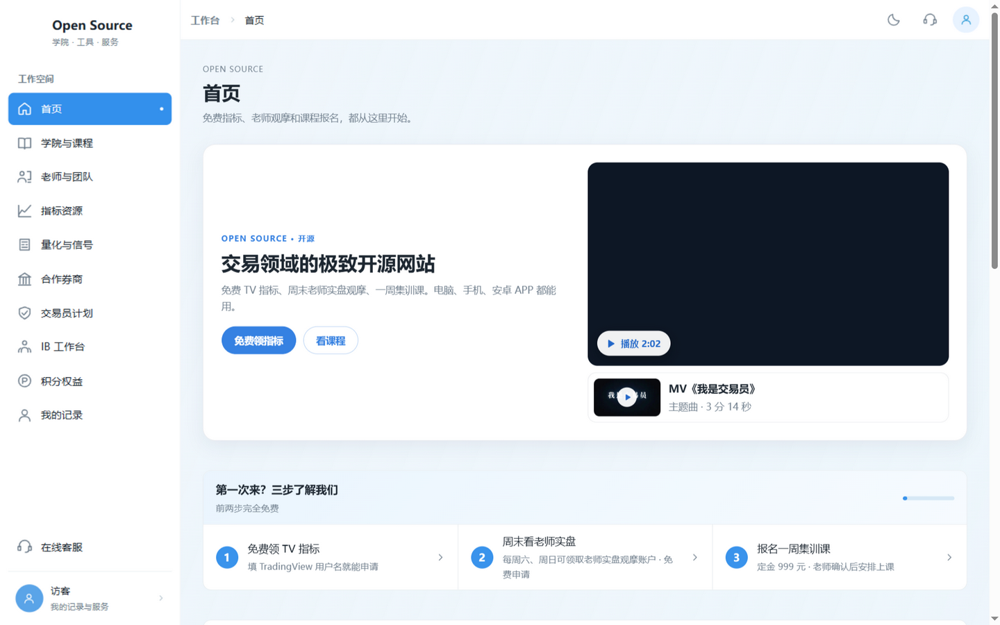
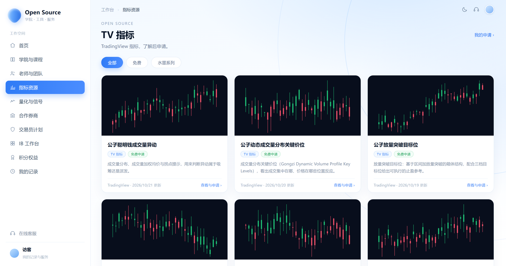
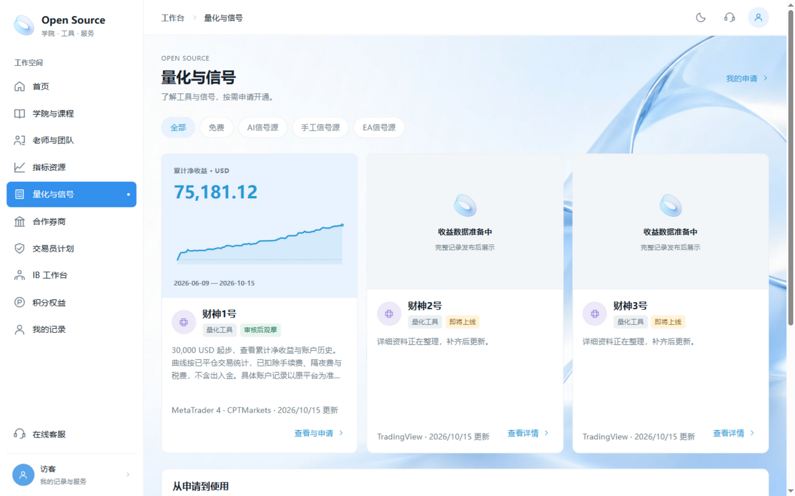
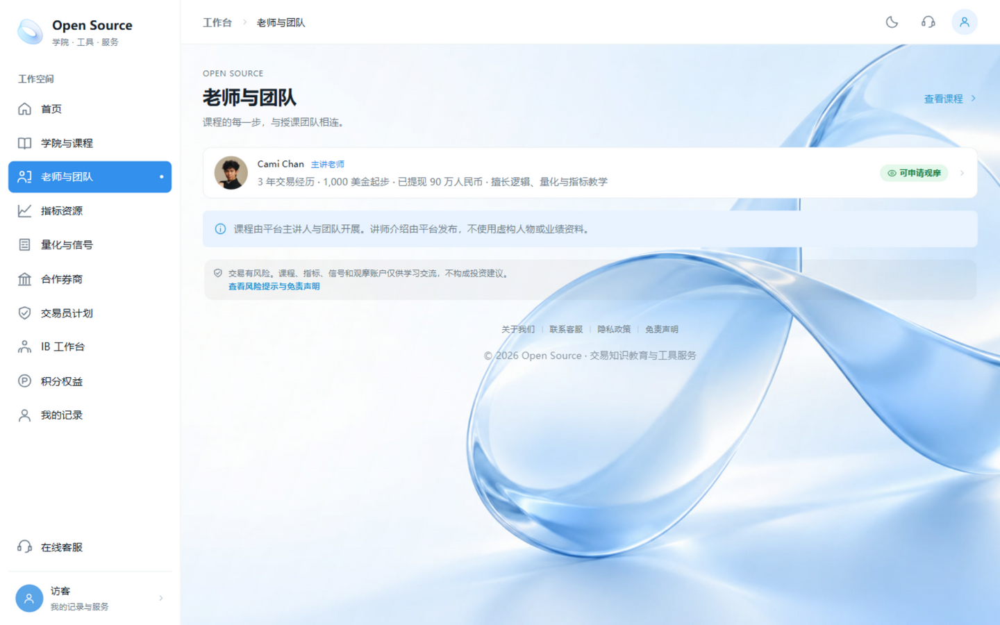
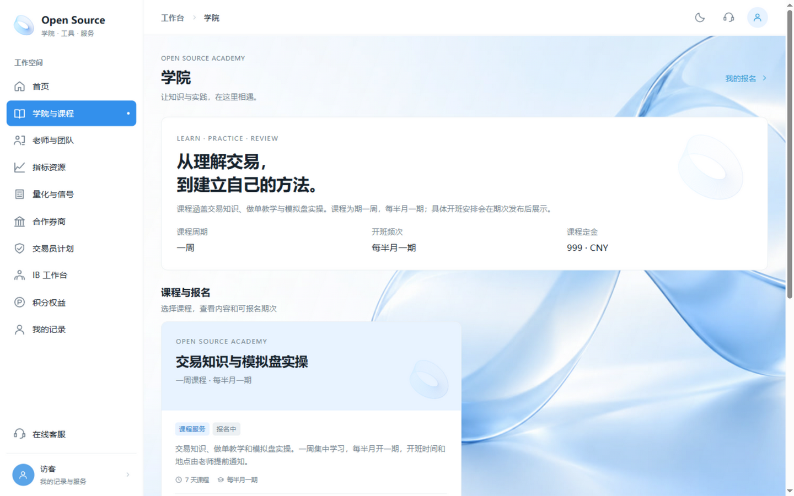
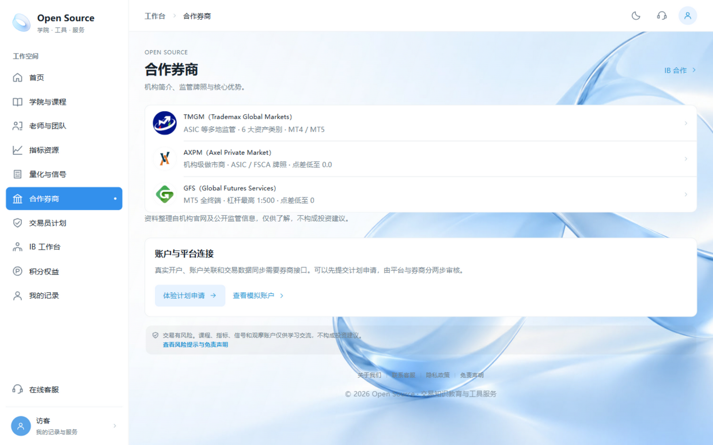
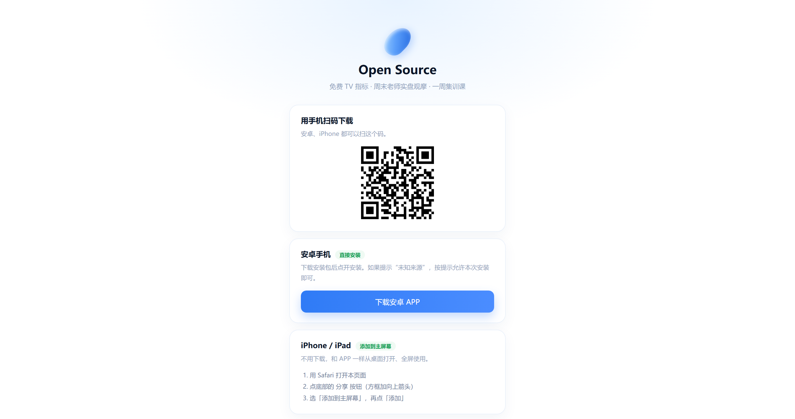
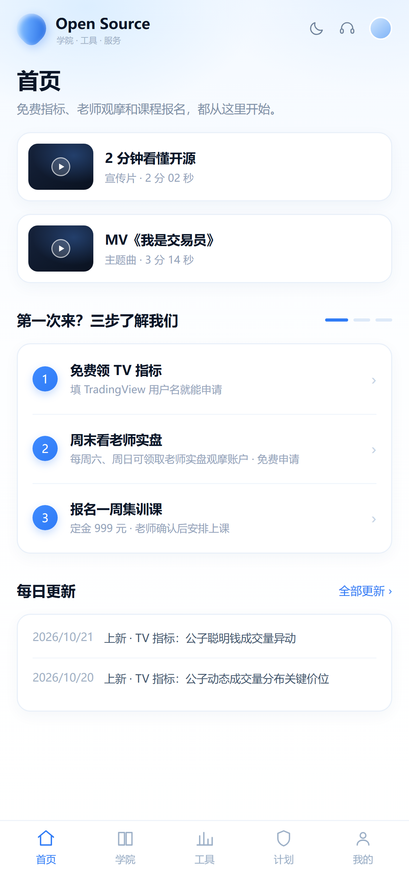
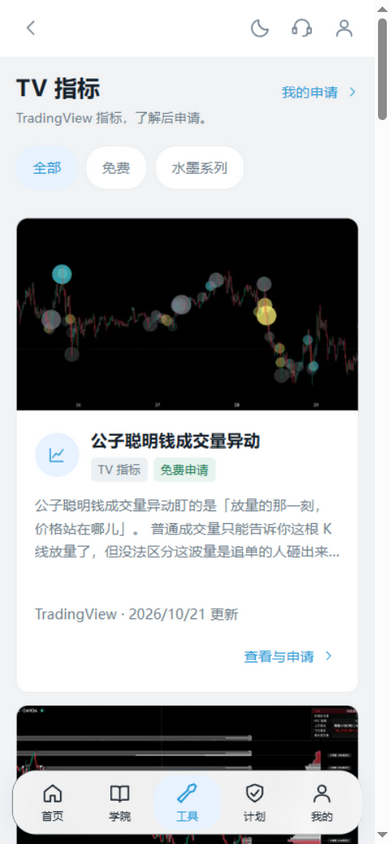

<div align="center">


<br>

# 开源 · Open Source

**交易领域的极致开源网站**

免费 TradingView 指标 · 量化信号 · 软件工具 · 一周集训课 · 合作券商 · 交易员计划 · IB 返佣 —— 一个入口全给。

<br>

[](https://opensourceoss.pages.dev/)
[](https://opensourceoss.pages.dev/)
[](https://opensourceoss.pages.dev/download)
[](https://opensourceoss.pages.dev/?noonboard=1#indicators)
[](https://opensourceoss.pages.dev/)

<br>

**[🌍 进入网站](https://opensourceoss.pages.dev/)** &nbsp;·&nbsp;
**[🧭 免费领指标](https://opensourceoss.pages.dev/?noonboard=1#indicators)** &nbsp;·&nbsp;
**[📱 下载 APP](https://opensourceoss.pages.dev/download)** &nbsp;·&nbsp;
**[🎓 看课程](https://opensourceoss.pages.dev/?noonboard=1#academy)**

</div>

---

## 目录

- [这是什么](#这是什么)
- [平台截图](#平台截图)
- [核心功能](#核心功能)
- [三步上手](#三步上手)
- [更新节奏](#更新节奏)
- [多端支持](#多端支持)
- [技术概况](#技术概况)
- [关于本仓库](#关于本仓库)
- [风险提示](#风险提示与免责声明)

---

## 这是什么

**「开源 Open Source」** 是一个面向交易者的学习与工具平台。

思路很简单：**免费的先给，觉得有用再谈进阶**。

- 先给 12 款免费 TradingView 指标、周末老师实盘观摩、量化信号一览；
- 想系统学，再走一周集训课（定金预约 · 人工核验 · 支持退定金）；
- 主讲老师 **Cami Chan** 真人实盘背书，资金流水公开可查。

首页还有 2 分钟宣传片和主题曲 MV《我是交易员》。

---

## 平台截图

<table>
  <tr>
    <td width="50%"><br><b align="center">首页 · 电脑端</b></td>
    <td width="50%"><br><b>TV 指标库</b> · 12 款免费指标</td>
  </tr>
  <tr>
    <td><br><b>量化与信号</b> · 老师实盘曲线公开</td>
    <td><br><b>老师与团队</b></td>
  </tr>
  <tr>
    <td><br><b>学院与课程</b> · 一周集训课</td>
    <td><br><b>合作券商</b> · TMGM / AXPM / GFS</td>
  </tr>
  <tr>
    <td><br><b>下载页</b> · 安卓 APP + iPhone 教程</td>
    <td><br><b>手机端首页</b></td>
  </tr>
</table>

<div align="center">
  
  <br>
  <b>手机端指标库</b>
</div>

---

## 核心功能

| | 功能 | 说明 |
| :---: | --- | --- |
| 🧭 | **免费 TV 指标 · 12 款** | 聪明钱成交量异动、动态成交量分布关键价位、放量突破目标位、流动性扫单猎手、水墨系列等。填 TradingView 用户名即可申请，**每天更新一款** |
| 📈 | **量化与信号源** | 财神系列信号源，老师实盘曲线公开可查；**每周六、日免费领取老师实盘观摩账户** |
| 🖥 | **软件工具 · 单练习神器** | 一个中文总控窗口同时管理多个独立 MT5，1 个喊单账号同步多个跟随账号（开仓 / 平仓 / 手数 / 止损止盈） |
| 🎓 | **一周集训课** | Cami Chan 主讲（3 年交易经历 · 1,000 美金起步）。交易知识 + 做单教学 + 模拟盘实操，每半月一期 |
| 🏦 | **合作券商** | TMGM、AXPM、GFS —— 机构简介、监管牌照、核心优势一览 |
| 🤝 | **交易员计划 / IB 返佣 / 积分权益** | 从学习到职业化的完整路径 |
| 💬 | **AI 在线客服** | 7×24 小时答疑，实时读取平台最新数据 |
| 🌗 | **浅色 / 深色** | Telegram 风格简洁界面，跟随你的习惯切换 |

---

## 三步上手

| 步骤 | 做什么 | 花钱吗 |
| :---: | --- | :---: |
| **1 · 免费领指标** | 填 TradingView 用户名提交申请，审核通过后发授权 | 免费 |
| **2 · 周末看实盘** | 每周六、日领取老师实盘观摩账户，先看再做 | 免费 |
| **3 · 预约集训课** | 定金预约，老师人工确认后安排上课，支持退定金 | 定金 |

---

## 更新节奏

| 内容 | 频率 |
| --- | --- |
| 免费指标 | 每天一款 |
| 信号源策略 | 每半个月一个 |
| 新增老师 | 每三个月一位 |

每次上新都会自动出现在首页「每日更新」和站内公告里。

---

## 多端支持

| 终端 | 怎么用 |
| :---: | --- |
| 💻 **电脑网页** | 直接打开 [opensourceoss.pages.dev](https://opensourceoss.pages.dev/) |
| 📱 **手机网页** | 手机浏览器打开同一网址，自动适配 |
| 🤖 **安卓 APP** | [下载页](https://opensourceoss.pages.dev/download) 扫码安装。APP 直接加载网站，**网页更新后 APP 自动生效**，不用重装 |
| 🍎 **iPhone / iPad** | Safari「添加到主屏幕」，免下载、全屏使用，下载页有图文教程 |

---

## 技术概况

平台运行在 **Cloudflare 全球网络**：

```
浏览器 / 安卓 APP / iPhone 主屏
            │
            ▼
Cloudflare Pages ── 静态资源全球 CDN，带内容指纹长期缓存
            │  /api/*
            ▼
Pages Functions ── D1 数据库 · Workers AI · 邮件验证码
```

- 页面秒开，不白屏；再次访问几乎零下载。
- 图片走 webp 小图 + 点开看原图，视频分段播放（iPhone 也能播）。
- 全站支持浅色 / 深色模式。

---

## 关于本仓库

> **本仓库仅用于产品展示与介绍，不包含源代码，也不适用开源许可。**
>
> 「开源 Open Source」是**品牌名称**，指"把免费资源开放给交易者"这一理念，不代表本站代码开源。
>
> 源码与素材由作者私有保存。需要技术交接、合作或商务洽谈，请通过网站「关于我们」页面的联系方式沟通。

---

## ⚠️ 风险提示与免责声明

> **交易有风险，入市需谨慎。**
>
> 本平台提供的课程、指标、信号源与观摩账户**仅供学习交流，不构成任何投资建议**；历史业绩不代表未来表现，任何收益展示都不构成承诺。请先使用模拟账户充分练习，再考虑实盘。
>
> 详见网站底部《[免责声明](https://opensourceoss.pages.dev/?noonboard=1#disclaimer)》与《[隐私政策](https://opensourceoss.pages.dev/?noonboard=1#privacy)》。

---

<div align="center">

**开源 · Open Source** —— 交易知识教育与工具服务

[网站](https://opensourceoss.pages.dev/) ｜ [下载 APP](https://opensourceoss.pages.dev/download) ｜ [关于我们](https://opensourceoss.pages.dev/?noonboard=1#about) ｜ [隐私政策](https://opensourceoss.pages.dev/?noonboard=1#privacy) ｜ [免责声明](https://opensourceoss.pages.dev/?noonboard=1#disclaimer)

<sub>© 2026 Open Source · 本页截图均来自正式网站</sub>

</div>
